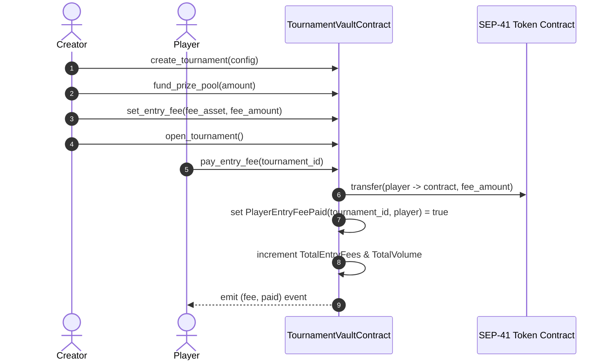

# Stellar Splash Contracts: Entry Fee Escrow Specification

## 1. Executive Summary
This specification defines the on-chain entry fee escrow mechanics for the Stellar Splash Soroban Smart Contract (`TournamentVaultContract`, deployed at `CACHWJEZY6JN36VFACWRQ7FP4T5EPRRRNBVLOSFHXTJHETZY36JD7QYJ`).

Entry fees enable tournament organizers to run buy-in tournaments, stake-to-play competitive brackets, and self-funding community events where player entry deposits directly augment the escrow vault reserves.

---

## 2. On-Chain Data Structures

### EntryFeeConfig
```rust
#[contracttype]
#[derive(Clone, Debug, Eq, PartialEq)]
pub struct EntryFeeConfig {
    pub fee_asset: Address,
    pub fee_amount: i128,
}
```

### Storage Keys
- `DataKey::EntryFee(u64)`: Stores `EntryFeeConfig` for a specific tournament ID.
- `DataKey::TotalEntryFees(u64)`: Stores cumulative entry fees collected in escrow for the tournament.
- `DataKey::PlayerEntryFeePaid(u64, Address)`: Boolean flag preventing double-charging players.

---

## 3. Entry Fee Lifecycle



### Phase 1: Configuration (`set_entry_fee`)
- **Caller**: Tournament creator exclusively (`creator.require_auth()`).
- **Preconditions**:
  - Contract is not in emergency pause (`is_paused() == false`).
  - Tournament must exist and be in `Created`, `Funding`, or `Funded` state.
  - `fee_amount >= 0` (negative fee amounts return `Error::InvalidAmount`).
- **Effect**: Configures entry asset and required deposit amount.

### Phase 2: Player Payment (`pay_entry_fee`)
- **Caller**: Joining player (`player.require_auth()`).
- **Preconditions**:
  - Contract is unpaused.
  - Tournament state must be `Open`.
  - Player must not have previously paid (`Error::EntryFeeAlreadyPaid`).
- **Execution**:
  - If `fee_amount > 0`, invokes `token::Client::transfer(&player, &contract, &fee_amount)`.
  - Increments `TotalEntryFees(tournament_id)` and contract-wide `TotalVolume`.
  - Records `PlayerEntryFeePaid(tournament_id, player) = true`.
  - Extends persistent storage TTLs by `STORAGE_LIFETIME_BUMP` (518,400 ledgers ~30 days).
  - Emits Soroban event `(symbol_short!("fee"), symbol_short!("paid")), (tournament_id, player, fee_amount)`.

---

## 4. Query Entrypoints

| Function | Return Type | Description |
| :--- | :--- | :--- |
| `get_entry_fee(tournament_id)` | `Result<EntryFeeConfig, Error>` | Returns configured fee asset and amount. Defaults to 0-fee if unset. |
| `get_total_entry_fees(tournament_id)` | `i128` | Cumulative entry fees locked in vault for the tournament. |
| `has_paid_entry_fee(tournament_id, player)` | `bool` | True if the specified player deposited the entry fee. |
| `get_contract_token_balance(token_address)` | `i128` | Contract vault reserves across all active tournament escrows. |

---

## 5. Security & Invariant Guarantees

1. **Strict Balance Conservation**: Every entry fee collected increments the contract's actual token balance by exactly `fee_amount`.
2. **Reentrancy & Double-Deposit Immunity**: Storage key `PlayerEntryFeePaid` prevents duplicate calls from deducting funds more than once.
3. **Emergency Circuit Breaker**: If `pause()` is engaged by admin, entry fee payments are immediately rejected with `Error::ContractPaused`.
4. **Dispute Settlement Lock**: Entry fee balances remain securely escrowed alongside the base prize pool and cannot be released while a dispute challenge is active.
