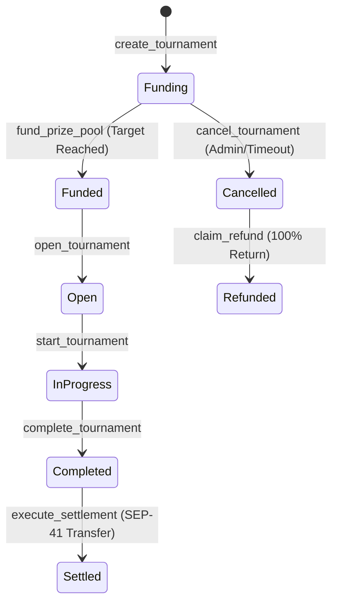

# Stellar Splash: Financial Governance & Mathematical Invariants

## 1. Executive Summary

In decentralized esports and skill-gaming, financial integrity is paramount. Minor rounding errors, unhandled token dust, or floating-point approximations in off-chain code or smart contracts can cause accounting reconciliation failures, insolvent prize escrows, or vulnerabilities to exploit.

Stellar Splash implements a formal **Financial Governance Framework** enforced across both the on-chain Soroban smart contracts (`stellar-splash-contracts`) and the off-chain deterministic settlement engine (`stellar-splash-engine`).

---

## 2. Core Invariants

### Invariant 1: Strict 10,000 Basis Points (bps) Invariant
Every prize agreement must specify recipient allocations in integer **Basis Points (bps)**, where:
$$1 \text{ bps} = 0.01\% \quad \text{and} \quad 10,000 \text{ bps} \equiv 100.00\%$$

Before any prize agreement can transition to `READY_TO_LOCK` or `LOCKED`, the sum of all allocation rules must equal exactly 10,000:
$$\sum_{i=1}^{n} b_i = 10,000 \quad \text{where } b_i \in \mathbb{Z}^+$$

Any agreement with $\sum b_i \ne 10,000$ is rejected with `INVALID_BASIS_POINTS`.

---

### Invariant 2: Discrete Integer Arithmetic (Stroop Precision)
Stellar tokens (including native XLM and SEP-41 tokens like USDC) utilize **7 decimal places** of precision:
$$1 \text{ XLM} = 10,000,000 \text{ Stroops} \quad (10^7 \text{ base units})$$

Floating-point numbers (`f32`, `f64`, or Javascript `Number`) are **strictly prohibited** in financial state transitions. All calculations in Soroban utilize `i128` signed integers, and all frontend and engine financial layers utilize `bigint`.

---

### Invariant 3: Deterministic Integer Floor Division
When dividing a prize pool $P$ (in Stroops) among ranks according to their basis points $b_i$, each rank's base share $S_i$ is calculated via integer floor division:
$$S_i = \left\lfloor \frac{P \times b_i}{10,000} \right\rfloor$$

Because floor division truncates fractional remainder units:
$$\sum_{i=1}^{n} S_i \le P$$

The total unallocated residual dust $D$ is defined as:
$$D = P - \sum_{i=1}^{n} S_i$$

Where $D$ is bounded strictly by:
$$0 \le D < n \ll 10,000 \text{ Stroops} \quad (< 0.001 \text{ XLM})$$

---

### Invariant 4: Deterministic Residual Dust Allocation to Rank 1
To prevent stranded escrow tokens in the vault contract, fractional dust remainder $D$ is deterministically allocated to **Rank 1 (Champion)**:
$$\text{Payout}_1 = S_1 + D$$
$$\text{Payout}_i = S_i \quad \forall i \in \{2, \dots, n\}$$

#### Mathematical Proof of Conservation:
$$\sum_{i=1}^{n} \text{Payout}_i = (S_1 + D) + \sum_{i=2}^{n} S_i = \left( \sum_{i=1}^{n} S_i \right) + D = \left( \sum_{i=1}^{n} S_i \right) + \left( P - \sum_{i=1}^{n} S_i \right) = P$$

$$\therefore \sum_{i=1}^{n} \text{Payout}_i \equiv P \quad \text{(Zero Tokens Lost or Minted)}$$

---

## 3. Escrow Lifecycle & State Machine

1. **Vault Segregation**: Each tournament has an isolated accounting ledger entry identifying its funded balance.
2. **Emergency Refund Guarantee**: If a tournament is cancelled (e.g., failure to meet quorum or network incident), `cancel_tournament` transitions state to `Cancelled`, and the creator/funder claims a 100% escrow refund via `claim_refund`.
3. **Emergency Circuit Breaker**: The contract admin can invoke `pause()` to freeze all state mutations if an anomaly is detected, protecting user assets until resolution.

---

## 4. Verification and Audit Matrix

| Mechanism | Off-Chain Engine | Smart Contract (Soroban) | Frontend (Client) |
|---|---|---|---|
| **10,000 Bps Invariant** | `AgreementService.validateBasisPoints` | Verified on agreement lock | `BasisPointsCalculator.isValidDistribution` |
| **Integer Arithmetic** | `bigint` (Stroops) | `i128` (Stroops) | `bigint` (Stroops) |
| **Dust Allocation** | Remainder $\to$ Rank 1 | Remainder $\to$ Rank 1 | Remainder $\to$ Rank 1 |
| **Asset Balance Verification** | Horizon balance query | SEP-41 `balance()` check | Freighter simulated balance |
| **Cancellation Refund** | Reconciliation monitor | `claim_refund` | Emergency refund UI action |

---

## 5. Conclusion

This financial governance structure guarantees that:
- Every Stroop deposited into the Soroban escrow is accounted for with cryptographic and mathematical certainty.
- No fractional dust remains trapped in smart contracts.
- Sponsors, players, and auditors can independently verify financial correctness using transparent, deterministic algorithms.
