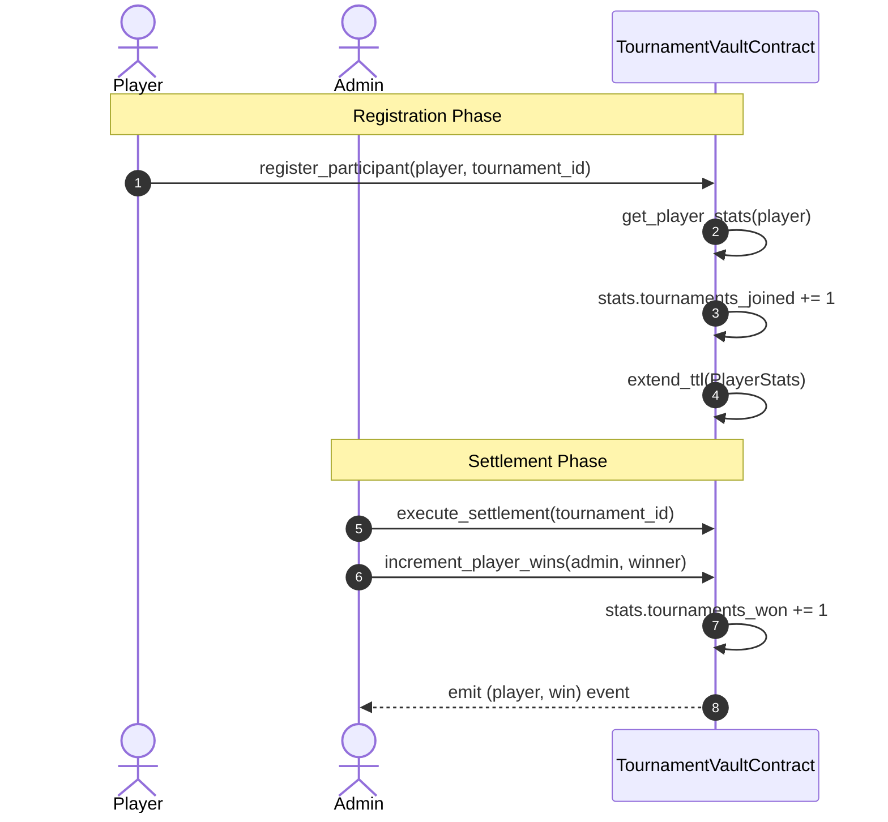

# Stellar Splash Contracts: On-Chain Player Reputation & Tournament Queries

## 1. Executive Summary
This specification documents the on-chain player reputation tracking and active tournament query mechanics implemented in the Stellar Splash Soroban Smart Contract (`TournamentVaultContract`).

Maintaining verified participation records directly on-chain creates an immutable reputation layer for competitive eSports on Stellar, enabling verifiable achievements, skill-based matchmaking, and tournament gating based on past performance.

---

## 2. On-Chain Data Structures

### PlayerStatsRecord
```rust
#[contracttype]
#[derive(Clone, Debug, Eq, PartialEq)]
pub struct PlayerStatsRecord {
    pub player: Address,
    pub tournaments_joined: u32,
    pub tournaments_won: u32,
    pub total_score: u64,
}
```

### Storage Model
- `DataKey::PlayerStats(Address)`: Stores `PlayerStatsRecord` indexed by player address in persistent storage.
- `DataKey::TournamentIdList`: Stores persistent `Vec<u64>` containing all tournament IDs created under this contract instance.

---

## 3. Reputation Lifecycle & Transitions



---

## 4. Entrypoint Reference

### `increment_player_wins`
- **Signature**: `pub fn increment_player_wins(env: Env, admin: Address, player: Address) -> Result<(), Error>`
- **Authorization**: Contract administrator only (`admin.require_auth()`).
- **Functionality**: Increments `tournaments_won` in `PlayerStatsRecord`, extends persistent storage TTL by 30 days (`STORAGE_LIFETIME_BUMP`), and emits Soroban event `(symbol_short!("player"), symbol_short!("win")), (player, new_win_count)`.

### `get_player_stats`
- **Signature**: `pub fn get_player_stats(env: Env, player: Address) -> PlayerStatsRecord`
- **Access**: Public view query (no authentication required).
- **Behavior**: Returns existing career record or default zeroed record (`tournaments_joined: 0, tournaments_won: 0, total_score: 0`).

### `get_active_tournaments`
- **Signature**: `pub fn get_active_tournaments(env: Env) -> Vec<u64>`
- **Access**: Public view query.
- **Behavior**: Iterates through `TournamentIdList` and filters out tournaments in `Completed` or `Cancelled` states, returning all active tournament pools.

---

## 5. Security & Invariant Guarantees

1. **Tamper-Proof Victories**: Only the designated contract administrative key can call `increment_player_wins`. Unauthorized callers receive `Error::Unauthorized`.
2. **Persistent Storage Retention**: Every update to `PlayerStatsRecord` triggers an automatic `extend_ttl` bump, guaranteeing player reputation records are not prematurely archived by network rent garbage collection.
3. **Deterministic Active State**: `get_active_tournaments` guarantees that settled and refunded tournaments are immediately excluded from active discovery without requiring off-chain indexer synchronization.
